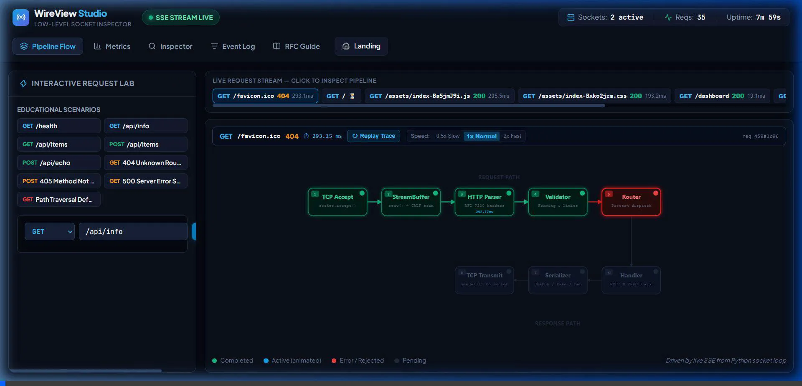
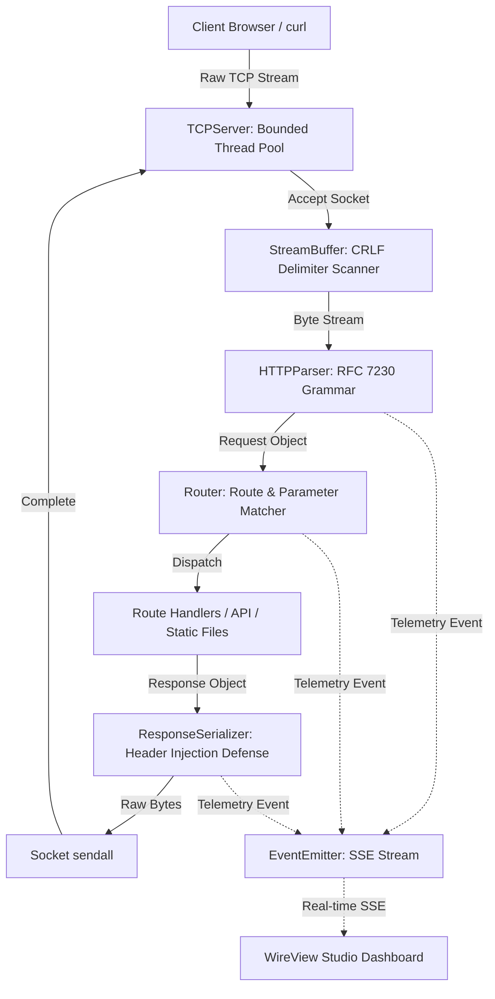

# WireView HTTP 🌐🔍

[](https://www.python.org/)
[](https://datatracker.ietf.org/doc/html/rfc7230)
[](https://react.dev/)
[](https://www.typescriptlang.org/)
[](tests/)
[](LICENSE)

> A low-level, RFC 7230-compliant **HTTP/1.1 server built entirely from scratch** on raw Berkeley TCP sockets using Python's standard library, paired with a modern **real-time React/TypeScript observability studio** powered by Server-Sent Events (SSE).

---

## 🖥️ Live Network & Protocol Simulation



> *Real-Time Network Telemetry & Protocol Simulation: Live TCP socket lifecycle, RFC 7230 streaming buffer pipeline, dynamic HTTP routing, wire-level header inspection, and live latency metrics telemetry powered by Server-Sent Events (SSE).*

---

## 📑 Table of Contents

- [Live Simulation](#-live-network--protocol-simulation)
- [Overview](#-overview)
- [Key Features](#-key-features)
- [Architecture & Pipeline](#-architecture--pipeline)
- [Project Structure](#-project-structure)
- [Security & RFC 7230 Compliance](#-security--rfc-7230-compliance)
- [Getting Started](#-getting-started)
  - [Prerequisites](#prerequisites)
  - [1. Running the HTTP Server](#1-running-the-http-server)
  - [2. Launching the Studio UI](#2-launching-the-studio-ui)
  - [3. Running the Test Suite](#3-running-the-test-suite)
- [API Endpoints](#-api-endpoints)
- [Author](#-author)

---

## 💡 Overview

Modern web developers frequently interact with high-level abstractions (`Flask`, `FastAPI`, `Express`, `Next.js`) without seeing the underlying mechanics of TCP streams, socket buffers, byte framing, and HTTP protocol parsing.

**WireView HTTP** strips away third-party frameworks to implement the complete HTTP/1.1 protocol from the transport layer up:
1. **Low-Level Socket Engine**: Direct `socket.socket(AF_INET, SOCK_STREAM)` manipulation with non-blocking timeouts, bounded thread pools, and persistent connection handling.
2. **Deterministic RFC 7230 Parser**: Custom stream buffer parsing request-lines, headers, and payloads byte-by-byte with strict whitespace and validation defenses.
3. **Real-Time Telemetry & Studio**: Integrated Server-Sent Events (SSE) broadcast engine paired with a reactive dashboard that visualizes each request as it traverses the connection, parse, routing, and serialization pipeline.

---

## ✨ Key Features

- **Zero-Dependency Core**: Server, socket manager, parser, router, serializer, and test suite require only the Python Standard Library.
- **Persistent Connections (`Keep-Alive`)**: Supports multiple sequential requests on a single persistent TCP connection per RFC 7230 §6.3.
- **Thread-Pool Concurrency**: Bounded worker thread pool with configurable limits to guard against resource exhaustion and Denial of Service.
- **Dynamic Path Routing**: Parameterized routes (e.g., `/api/items/{id}`), typed handlers, and automatic `OPTIONS` preflight handling.
- **Live Observability Studio**: Modern React 19 + TypeScript dashboard displaying live request latency, throughput, connection states, and wire inspections.
- **Built-in Fallback Dashboard**: The server includes an embedded fallback dashboard so the UI works out-of-the-box even without compiling the frontend.
- **Comprehensive Test Suite**: 33 automated tests verifying streaming buffers, protocol parsing, security constraints, and live network stress.

---

## 🏛 Architecture & Pipeline



### Request Lifecycle
1. **Connection**: Client establishes a 3-way TCP handshake with `TCPServer`. An available worker thread accepts the client socket.
2. **Buffered Ingestion**: `StreamBuffer` reads raw bytes incrementally, avoiding memory exhaustion while scanning for `\r\n\r\n` header delimiters.
3. **Grammar Parsing**: `HTTPParser` validates the method token, normalized request target URI, HTTP version, and header fields.
4. **Routing**: `Router` matches path templates and extracts path variables.
5. **Serialization**: `ResponseSerializer` compiles status line, headers, and payload into wire format with verified byte lengths.
6. **Telemetry**: Pipeline events are broadcast over `/api/events` via Server-Sent Events (SSE) directly to the visualizer.

---

## 📁 Project Structure

```plaintext
CN_Project/
├── server/                                # Python Socket Server Engine
│   ├── __init__.py
│   ├── buffer.py                         # Incremental TCP stream buffer
│   ├── config.py                         # Server runtime configuration
│   ├── errors.py                         # HTTP exception hierarchy (400, 404, 405, 500)
│   ├── events.py                         # Thread-safe event emitter & ring buffer
│   ├── handlers.py                       # Route handlers & fallback studio UI
│   ├── models.py                         # Request and Response abstractions
│   ├── parser.py                         # RFC 7230 byte-level HTTP parser
│   ├── router.py                         # URL dispatcher with parameterized routes
│   ├── serializer.py                     # HTTP response serializer with injection defense
│   ├── sse.py                            # Server-Sent Events protocol implementation
│   └── tcp_server.py                     # Multi-threaded TCP socket listener
├── studio/                               # Observability Studio Frontend
│   ├── src/
│   │   ├── components/                   # Metrics, Pipeline, and Inspector components
│   │   ├── App.tsx                       # Main Studio application
│   │   └── types.ts                      # Protocol & telemetry data types
│   ├── package.json
│   └── vite.config.ts
├── tests/                                # Automated Test Suite
│   ├── run_tests.py                      # Test runner
│   ├── test_buffer.py                    # Buffer fragmentation & limit tests
│   ├── test_parser.py                    # RFC 7230 validation & threat defense tests
│   ├── test_router.py                    # Routing and CORS tests
│   ├── test_serializer.py                # Header injection & byte length tests
│   └── test_server_live.py               # Live multi-threaded network stress tests
├── run_server.py                         # CLI entrypoint to launch server
├── requirements.txt                      # Project dependency manifest
├── generate_report.py                    # Documentation generator (Word report)
├── generate_ppt.py                       # Presentation generator (PowerPoint slides)
└── README.md
```

---

## 🛡 Security & RFC 7230 Compliance

| Defense Mechanism | RFC / Security Standard | Implementation |
|---|---|---|
| **CRLF Header Injection** | RFC 7230 §3.2.4 | Rejects or strips `\r` and `\n` in custom header values to prevent response splitting. |
| **Path Traversal Defense** | CWE-22 | Resolves and validates requested files strictly against root static directories, blocking `../` escapes. |
| **Request Smuggling Defense** | RFC 7230 §3.3.3 | Rejects requests specifying both `Transfer-Encoding` and `Content-Length` with `400 Bad Request`. |
| **Whitespace Strictness** | RFC 7230 §3.2.4 | Rejects leading whitespace before colon separators in header fields. |
| **Payload Size Protection** | Denial-of-Service Defense | Enforces strict maximum limits on request-line length, header byte count, and body size. |

---

## 🚀 Getting Started

### Prerequisites

- **Python**: 3.10 or higher
- **Node.js**: 18+ and **npm** *(optional, only needed for modifying the Studio frontend)*

### 1. Running the HTTP Server

Run the server with zero external dependencies:

```bash
# Launch on default port 8080
python run_server.py

# Custom host, port, or concurrency pool limit
python run_server.py --host 127.0.0.1 --port 9000 --workers 64 --verbose
```

Open your browser to:
- **Landing Page**: [http://127.0.0.1:8080/](http://127.0.0.1:8080/)
- **Live Studio Dashboard**: [http://127.0.0.1:8080/dashboard](http://127.0.0.1:8080/dashboard)
- **Health Endpoint**: [http://127.0.0.1:8080/health](http://127.0.0.1:8080/health)

### 2. Launching the Studio UI (Development Mode)

If you wish to run the interactive React/Vite development server:

```bash
cd studio
npm install
npm run dev
```

To compile production assets served directly by the Python backend:

```bash
cd studio
npm run build
```

### 3. Running the Test Suite

Execute all 33 unit and live integration tests:

```bash
python tests/run_tests.py
```

Sample output:
```text
Ran 33 tests in 0.588s

OK
```

---

## 📡 API Endpoints

| Method | Endpoint | Description |
|---|---|---|
| `GET` | `/` | Welcoming landing page with quick navigation links |
| `GET` | `/dashboard` | Interactive WireView Studio real-time dashboard |
| `GET` | `/health` | Server uptime, memory, and status check |
| `GET` | `/api/metrics` | Server metrics (connections, requests, latencies) |
| `GET` | `/api/events` | Server-Sent Events (SSE) telemetry stream |
| `GET` | `/api/items` | List sample networking RFC and protocol items |
| `POST` | `/api/items` | Create a new protocol entry (JSON body) |
| `GET` | `/api/items/{id}` | Retrieve details for a specific item |
| `DELETE` | `/api/items/{id}`| Remove an item by ID |
| `POST` | `/api/echo` | Echoes back received headers and request body |

---

## 👤 Author

Developed by **[Ayush Singh](https://github.com/ayuushhxx)**.
